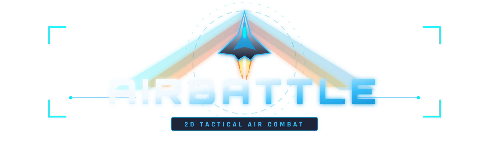

# AirBattle

<p align="center">
  
</p>

<p align="center">
  
  
  
  
  
  
</p>

---

## 📖 Introduction // 简介

### [English]
**AirBattle** is a 2D air combat game. Originally developed in C++, this modernized web edition is built with **TypeScript**, **PixiJS**, and **Web Audio API**, offering optimized gameplay, responsive controls, and enhanced audiovisual effects. It runs smoothly in modern web browsers and can also be packaged as a standalone desktop application via Electron.

### [中文]
**AirBattle** 是一款 2D 空战游戏。该版本由早期的 C++ 版本重构而来，基于 **TypeScript**、**PixiJS** 与 **Web Audio API** 实现，对游戏性、操控体验与音画效果进行了全面优化。支持在现代网页浏览器中直接游玩，亦可通过 Electron 打包为独立桌面应用。

---

## 🛠️ Tech Stack // 技术架构

- **Language**: TypeScript
- **Rendering Engine**: PixiJS v8
- **Audio Engine**: Howler.js + Web Audio API
- **Build Tool**: Vite
- **Desktop Runtime**: Electron + Inno Setup

---

## 🚀 Quick Start // 快速开始

### Prerequisites
- Node.js (v18.0.0 or higher)
- npm or pnpm

### Development
```bash
# Clone the repository
git clone https://github.com/Yodeesy/AirBattle.git
cd AirBattle

# Switch to this branch
git checkout feat/v2-web-edition

# Install dependencies
npm install

# Start local development server
npm run dev
```

### Production Build
```bash
# Build web bundle
npm run build

# Preview build
npm run preview
```

### Desktop Packaging
```bash
# Package desktop app
npm run pack
```

---

## ⚖️ Intellectual Property & Copyright Disclaimer // 版权归属与知识产权声明

### [English]
1. **Non-Commercial Purpose**: This project is a personal, non-commercial open-source project intended purely for learning, technical research, and educational purposes.
2. **Resource Attribution**: All external art assets (images, sprites, videos) and musical compositions used in this project do not belong to the author and remain the intellectual property of their respective original copyright holders and creators.
3. **Respect for IP**: We hold high respect for intellectual property rights. If any copyright owner has concerns regarding the materials included in this repository, please contact the maintainer, and the relevant assets will be promptly removed or adjusted.

### [中文]
1. **非商业声明**：本项目为个人开源学习与技术研究项目，不包含任何商业营利行为。
2. **资源版权归属**：游戏内所使用的美术素材（图片、精灵、视频片段）及音乐资源版权均不属于作者本人，其知识产权完全归属于各自的原作者、出版机构及版权所有方。
3. **尊重知识产权**：作者高度尊重知识产权与原创成果。若任何版权方认为项目中引用的资源存在不妥之处，请联系作者，相关素材将第一时间配合核实并予以移除或调整。

---

## 🤖 AI Development Attribution // AI 辅助声明

The code refactoring, modernization, and optimization of this edition were assisted and executed by Google DeepMind's **Antigravity-Gemini 3.8 Flash** model.

本项目本轮代码重构、技术栈升级与工程优化由 Google DeepMind **Antigravity-Gemini 3.8 Flash** 模型辅助执行完成。

---

## 📄 License // 开源协议

The source code of this project is licensed under the [MIT License](LICENSE).
