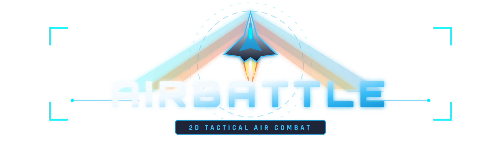

<p align="right">
  <a href="README.md">English</a> | <b>简体中文</b>
</p>

# AirBattle

<p align="center">
  
</p>

<p align="center">
  <a href="https://yodeesy.github.io/AirBattle/">
    
  </a>
</p>

<p align="center">
  
  
  
  
</p>

---

## 📖 游戏简介

**AirBattle** 是一款 2D 空战游戏。该版本由早期的 C++ 版本重构而来，基于 **TypeScript**、**PixiJS** 与 **Web Audio API** 实现，对游戏性、操控体验与音画效果进行了全面优化。游戏支持在现代网页浏览器中直接在线游玩，亦可通过 Electron 打包为独立桌面应用。

---

## 🛠️ 技术架构

- **编程语言**：TypeScript
- **渲染引擎**：PixiJS v8
- **音频引擎**：Howler.js + Web Audio API
- **构建工具**：Vite
- **桌面运行环境**：Electron + Inno Setup

---

## 🚀 快速开始

### 环境要求
- Node.js (v18.0.0 或更高版本)
- npm 或 pnpm

### 本地开发与运行
```bash
git clone https://github.com/Yodeesy/AirBattle.git
cd AirBattle
git checkout feat/v2-web-edition
npm install
npm run dev
```

### 生产打包
```bash
npm run build
npm run preview
```

### 桌面端打包
```bash
npm run pack
```

---

## ⚖️ 知识产权与版权声明

1. **非商业声明**：本项目为个人开源学习与技术研究项目，不包含任何商业营利行为。
2. **资源版权归属**：游戏内所使用的美术素材（图片、精灵、视频片段）及音乐资源版权均不属于作者本人，其知识产权完全归属于各自的原作者、出版机构及版权所有方。
3. **尊重知识产权**：作者高度尊重知识产权与原创成果。若任何版权方认为项目中引用的资源存在不妥之处，请联系作者，相关素材将第一时间配合核实并予以移除或调整。

---

## 🤖 AI 辅助声明

本项目本轮代码重构、技术栈升级与工程优化由 Google DeepMind **Antigravity-Gemini 3.8 Flash** 模型辅助执行完成。

---

## 📄 开源协议

本项目源码采用 [MIT License](LICENSE) 授权。
